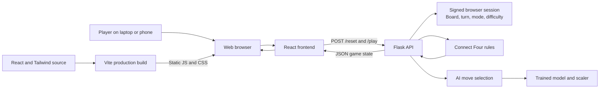
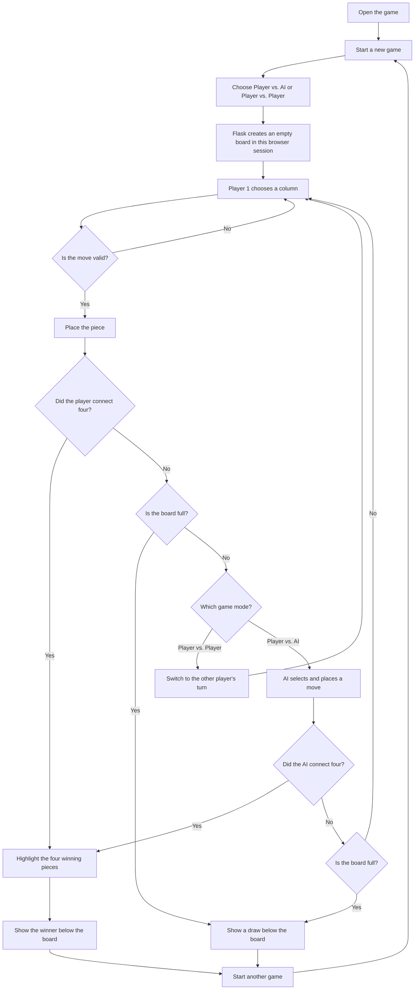

# Connect 4 AI Duel

A responsive Connect Four web game built with React and Tailwind CSS, served by Flask. Play against the AI at three difficulty levels, or play locally with a friend in Player vs. Player mode.

## Project architecture



Each visitor's board and game settings are stored in that visitor's signed browser session, so separate players do not share a game.

## Game cycle



## Run in VS Code on Windows

### Prerequisites

- Python 3.12
- Node.js 22 LTS (includes npm)
- Visual Studio Code

Open this project folder in VS Code, then choose **Terminal → New Terminal**. Run the following commands from the project root using PowerShell.

### 1. Create and install the Python environment

```powershell
py -3.12 -m venv .venv
.\.venv\Scripts\python.exe -m pip install --upgrade pip
.\.venv\Scripts\python.exe -m pip install -r requirements.txt
```

### 2. Install and build the frontend

```powershell
npm ci
npm run build
```

The build generates `static/dist/app.js` and `static/dist/main.css`, which Flask serves to the browser. Re-run `npm run build` after editing files under `frontend/src`.

### 3. Start the web game

```powershell
.\.venv\Scripts\python.exe app.py
```

Open **http://127.0.0.1:5000** in a browser. Leave the VS Code terminal running while playing; press **Ctrl+C** in that terminal to stop the server.

## Deploy to the web

The Docker image builds the React/Tailwind frontend and runs Flask with Gunicorn. A Render Blueprint is included in `render.yaml`.

### Deploy with Render

1. Push this repository to GitHub.
2. In Render, choose **New → Blueprint** and connect this GitHub repository.
3. Apply the Blueprint. Render reads `render.yaml` and builds the Docker image.
4. In the service settings, set `SECRET_KEY` to a long, randomly generated value if it is not already generated from the Blueprint.
5. Open the public URL provided by Render.

### Build and run the container locally

Install and start Docker Desktop, then run these PowerShell commands:

```powershell
docker build -t connect4-ai-duel .
$env:SECRET_KEY = "replace-with-a-long-random-secret"
docker run --rm -p 10000:10000 -e SECRET_KEY=$env:SECRET_KEY -e SESSION_COOKIE_SECURE=false connect4-ai-duel
```

Open **http://127.0.0.1:10000**. The `SESSION_COOKIE_SECURE=false` override is only for local HTTP testing. HTTPS deployments should keep secure cookies enabled. Never use the development fallback secret in production.

## Repository layout

```text
frontend/src/     React UI and Tailwind styles
templates/        Flask HTML entry point
static/dist/      Generated frontend assets (created by npm run build)
app.py            Flask routes and per-browser game sessions
game_logic.py     Connect Four board and win rules
ai_logic.py       AI strategies and model loading
models/           Trained AI model and scaler
data/             Training dataset used by train_model.py
Dockerfile        Production container build
render.yaml       Render deployment blueprint
```
